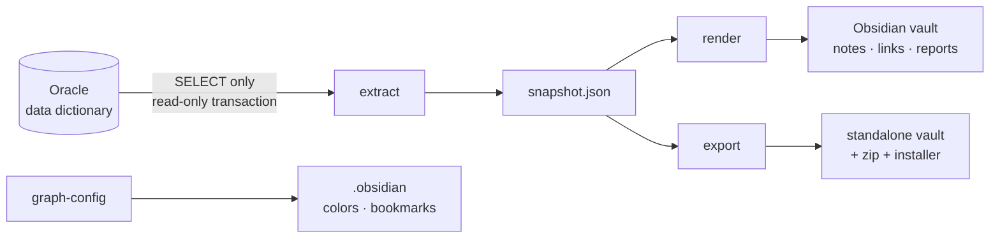

# DbViz

**Turn an Oracle schema into a navigable Obsidian knowledge base.**

[](https://github.com/AlexeyDavidenko/DbViz/actions/workflows/ci.yml)
[](LICENSE)
[](https://dotnet.microsoft.com/)

DbViz reads the Oracle data dictionary (read-only) and generates one Markdown note per database object —
tables, views, materialized views, packages, procedures, functions, triggers, sequences, synonyms, types,
DB links and scheduler jobs — with columns, parameters, keys, indexes, source code and every relationship
expressed as Obsidian `[[wikilinks]]`. Objects are grouped into **layers**, so Obsidian's graph view becomes
a colored, filterable map of the schema.

---

## Features

- **One note per object** with properties, columns / parameters, PK / UK / FK / CHECK constraints, indexes,
  collapsed PL/SQL source and compilation errors.
- **Typed relationships**: foreign keys, dependencies (`ALL_DEPENDENCIES`), trigger → table, synonym → target,
  job → called object, access through DB links. Each note lists outgoing *and* incoming links.
- **Layers** — Storage (tables, sequences), Access (views, synonyms), Logic (packages, procedures, functions, triggers),
  Types & Integration (types, DB links, jobs) — as folders, tags, graph colors and ready-made graph presets.
- **Diagrams**: Mermaid ER diagram for every table (FK, 1 hop) and a "who uses → object → what it uses" flowchart
  with clickable, layer-colored nodes.
- **Schema home page**, per-type indexes and **quality reports**: invalid objects, tables without a primary key,
  foreign keys without a supporting index, undocumented objects, unused objects, external dependencies.
- **Your edits survive regeneration**: the generator owns only `%% AUTO:BEGIN … %%` blocks and its own frontmatter keys.
  Objects dropped from the database are moved to `_archive/`, never deleted.
- **Graph presets as bookmarks** ("Tables only", "Tables + views", "Logic + tables", …) applied to your vault with one command.
- **Shareable standalone vault**: a zip that colleagues open as-is, plus an installer that merges notes, colors and
  bookmarks into *their* existing vault (macOS and Windows).
- **Strictly read-only** — see [Safety](#safety).

## How it works



1. **extract** runs a fixed set of dictionary queries (`ALL_OBJECTS`, `ALL_TAB_COLS`, `ALL_CONSTRAINTS`, `ALL_DEPENDENCIES`,
   `ALL_ARGUMENTS`, `ALL_SOURCE`, …) for one schema and stores the raw result as a JSON **snapshot**.
2. **render** builds a logical model from the snapshot (merging `PACKAGE` + `PACKAGE BODY`, hiding system noise,
   resolving cross-schema references) and writes notes into the vault — only files whose content changed.
3. **graph-config** writes layer color groups and preset bookmarks into the vault's `.obsidian` settings.
4. **export** produces a standalone vault and a zip archive for people without database access.

Keeping the snapshot separate means you can re-render and iterate on the output without touching the database,
and diff snapshots over time to see how the schema evolves.

### Vault layout

```
<vault>/<section>/<SCHEMA>/
├── <SCHEMA>.md                 schema home: layers, counts, reports, graph presets
├── 10 Tables/  11 Sequences/
├── 20 Views/   21 Materialized Views/   22 Synonyms/
├── 30 Packages/  31 Procedures/  32 Functions/  33 Triggers/
├── 40 Types/   41 DB Links/   42 Jobs/
├── _index/                     per-type tables of contents
├── _reports/                   quality reports
└── _archive/                   notes of objects that no longer exist
```

Note names are `SCHEMA.OBJECT` (e.g. `HR.EMPLOYEES`); triggers, jobs and DB links get a suffix
(`~TRG`, `~JOB`, `~DBLINK`) because they live in separate Oracle namespaces.

## Safety

DbViz is designed to be pointed at production databases:

- **Only dictionary `SELECT`s.** All SQL lives in [`DictionaryQueries.cs`](src/DbViz.Oracle/DictionaryQueries.cs);
  every query is filtered by `OWNER = :owner`. Print them with `dbviz queries` and show them to your DBA.
- **`ReadOnlyGuard`** rejects anything that is not a single `SELECT`/`WITH` (DML, DDL, PL/SQL, `FOR UPDATE`, DB links)
  before it reaches the driver. It is covered by tests and runs in CI.
- The session runs inside **`SET TRANSACTION READ ONLY`** and identifies itself as `MODULE = DbViz` in `V$SESSION`.
- **No table data is read** — only metadata (row counts come from optimizer statistics).
- Credentials and the database address are kept out of git (`config/credentials.json` or environment variables).
  Snapshots, logs, exports and archives are git-ignored.

## Requirements

- [.NET 10 SDK](https://dotnet.microsoft.com/download) (Windows, macOS or Linux)
- Oracle Database 12.2+ (developed and tested against 19c). No Oracle Client needed — the managed thin driver is used.
- A database user that can see the schema in `ALL_*` views. Connecting as the schema owner gives the most complete
  result (package bodies of other owners are hidden from `ALL_SOURCE` without extra privileges).
- [Obsidian](https://obsidian.md) 1.4+. No community plugins required.

## Installation

```bash
git clone https://github.com/AlexeyDavidenko/DbViz.git
cd DbViz
dotnet build DbViz.sln

cp config/dbviz.example.json        config/dbviz.json          # schema, vault path (git-ignored)
cp config/credentials.example.json  config/credentials.json    # dataSource, user, password (git-ignored)
```

`config/credentials.json`:

```json
{
  "dataSource": "//db-host:1521/SERVICE_NAME",
  "user": "HR",
  "password": "…"
}
```

JDBC URLs (`jdbc:oracle:thin:@//host:1521/service`) are accepted as well. Alternatively set
`DBVIZ_DATASOURCE`, `DBVIZ_USER` and `DBVIZ_PASSWORD` — environment variables take precedence over the file.

`config/dbviz.json`:

| Key | Meaning |
|---|---|
| `schema` | Owner to document (exactly one) |
| `vault.root` | Path to your Obsidian vault (the folder that contains `.obsidian`) |
| `vault.section` | Folder inside the vault; notes go to `<root>/<section>/<schema>/` |
| `snapshotPath` | Snapshot location, default `out/snapshot/<schema>.json` |
| `logDir` | Log folder, default `out/logs` |
| `commandTimeoutSeconds` | Per-query timeout |
| `maxSourceLines` | Longest PL/SQL source shown in a note |
| `excludeNamePatterns`, `excludedRefOwners` | Override the default filters for system objects and noise schemas |

## Usage

```bash
alias dbviz="dotnet run --project src/DbViz.Cli --"

dbviz queries        # print every SQL statement the tool can run
dbviz check          # test the connection, show object counts
dbviz sync           # extract + render into the vault
dbviz graph-config   # apply layer colors and preset bookmarks to the vault
```

| Command | What it does | Needs DB |
|---|---|---|
| `check` | Connected user, DB version, object counts by type | yes |
| `extract` | Dictionary → snapshot JSON | yes |
| `render` | Snapshot → notes in the vault | no |
| `sync` | `extract` + `render` | yes |
| `stats` | Summary of the current snapshot | no |
| `queries` | Print all SQL (each one passes the read-only guard) | no |
| `graph-config` | Layer colors + preset bookmarks into `<vault>/.obsidian` (backs up first) | no |
| `export` | Standalone vault + zip with installer, see [Sharing](#sharing-with-colleagues) | no |
| `demo` | Render a fictional DEMO schema into `out/demo-vault` to preview the output | no |

Options: `--config <path>`, `--snapshot <path>`, `--vault <path>`, `--out <path>` (for `demo` / `export`).
Every run writes a log to `out/logs/`.

After `graph-config`, reload Obsidian (**Cmd/Ctrl+P → "Reload app without saving"**) so it picks up the new settings.

### Exploring the graph

Open **Bookmarks → "DBVisualization · &lt;SCHEMA&gt;"** for ready-made views, or type a query into the graph's *Filters* field:

| View | Query |
|---|---|
| Whole schema | `tag:#schema/HR -tag:#dbviz` |
| Tables only (FK) | `tag:#schema/HR tag:#db/table` |
| Tables + views | `tag:#schema/HR (tag:#db/table OR tag:#db/view)` |
| Logic + tables | `tag:#schema/HR (tag:#layer/logic OR tag:#db/table)` |
| Everything but views | `tag:#schema/HR -tag:#dbviz -tag:#db/view` |

Prefix a condition with `-` to hide a layer. For a single object use *Open local graph* in its note.

### Sharing with colleagues

```bash
dbviz export          # → out/export/DbViz-<SCHEMA>-<date>.zip
```

The archive contains a complete vault with its own `.obsidian` (colors, arrows, bookmarks) and a start page.
Recipients can either:

1. **Open it as a separate vault** — Obsidian → *Open folder as vault* → `DbViz-<SCHEMA>`; or
2. **Add it to their own vault** — close Obsidian and run the installer from `_Install/`
   (`Install into my vault (macOS).command` or `… (Windows).cmd`). It copies the notes (optional), merges color groups, bookmarks and
   required core plugins into their settings, keeps everything they already have and makes backups.

Copying the folder manually is not enough for option 2: colors and bookmarks live in the hidden `.obsidian`
folder of the vault that is opened.

> The archive contains schema metadata and full PL/SQL source. Decide who may receive it.

## Development

```bash
dotnet test DbViz.sln                         # unit + integration tests (no database needed)
dotnet run --project src/DbViz.Cli -- demo    # preview the output on the fictional DEMO schema
```

```
src/DbViz.Core      snapshot model, SchemaIndex (objects + typed edges), DEMO schema
src/DbViz.Oracle    ReadOnlyGuard, DictionaryQueries, QueryRunner, OracleExtractor
src/DbViz.Obsidian  NoteRenderer, IndexPages, NoteMerger, VaultWriter, GraphPresets,
                    ObsidianConfigWriter, StandaloneExporter, Installer/ (JXA + PowerShell)
src/DbViz.Cli       commands, configuration, logging
tests/DbViz.Tests   guard, merge of manual edits, link integrity, idempotent re-render, export, installer
```

All development and tests run against the fictional DEMO schema; no real database is required.
CI builds and tests on Linux, Windows and macOS.

## Limitations & roadmap

- Package-level dependencies only: `ALL_DEPENDENCIES` does not say *which* subprogram touches a table, nor whether it
  reads or writes. Planned: PL/SQL parsing for per-subprogram read/write edges and a CRUD matrix.
- No column-level lineage for views yet.
- Dynamic SQL (`EXECUTE IMMEDIATE`) and access from external applications are invisible to the dictionary.
- Planned: generated Canvas boards per layer/domain with labeled, colored edges; Bases-powered reports; localization of note templates.
- The Windows installer has not yet been verified on a real Windows machine.

## License

Licensed under the [Apache License, Version 2.0](LICENSE).
Copyright 2026 AlexeyDavidenko.
